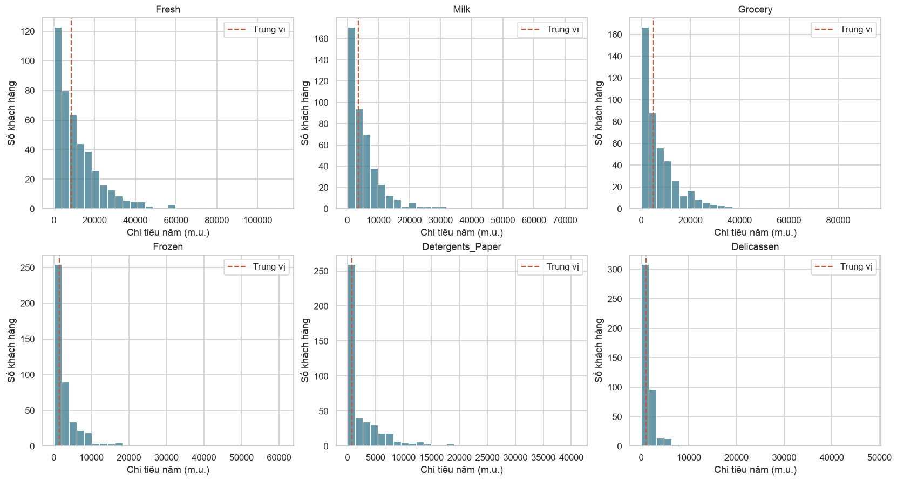
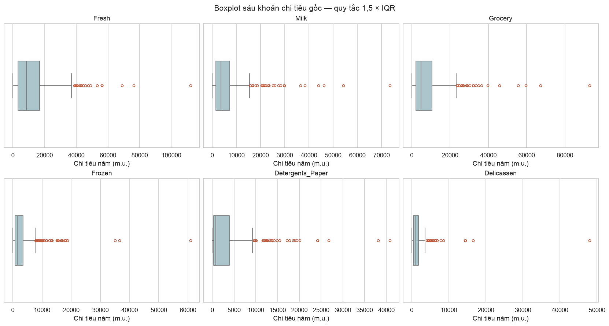
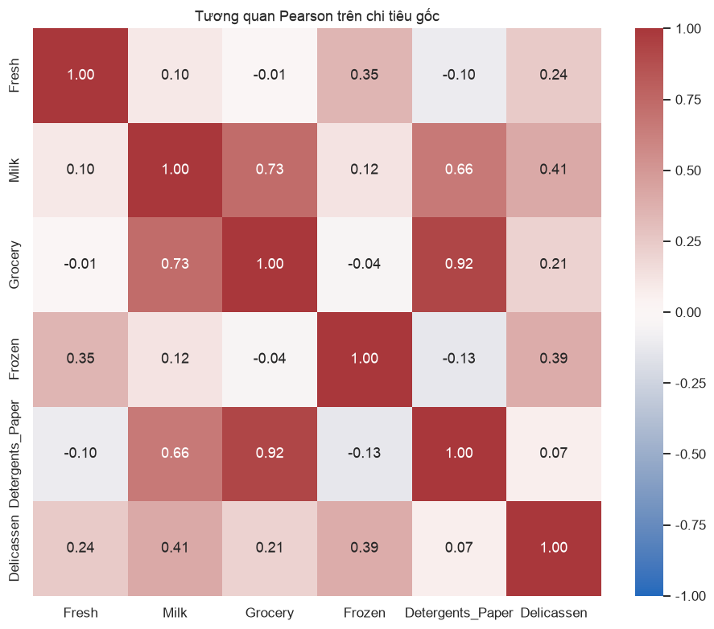

# Nhận xét EDA dữ liệu khách hàng bán buôn

Tài liệu tổng hợp các nhận xét từ kết quả phân tích trong `eda.ipynb`.

CSV nguồn: `data/raw/wholesale_customers.csv`  

Nguồn: [Wholesale Customers — UCI](https://archive.ics.uci.edu/dataset/292/wholesale+customers). Cardoso, M. (2013), DOI: [10.24432/C5030X](https://doi.org/10.24432/C5030X), giấy phép CC BY 4.0.

Mỗi dòng là một khách hàng. Sáu cột Fresh, Milk, Grocery, Frozen, Detergents_Paper và Delicassen là chi tiêu năm theo đơn vị tiền tệ (m.u.). Channel và Region là mã nhóm phân loại, không phải số tiền.

## 1. Thư viện và đường dẫn

Đọc file CSV có sẵn trong dự án bằng pandas; dùng Matplotlib/Seaborn để hiển thị dữ liệu.

## 2. Xem các dòng mẫu và cấu trúc dữ liệu

Ý nghĩa sáu cột chi tiêu: Fresh (thực phẩm tươi), Milk (sữa), Grocery (hàng tạp hóa), Frozen (đông lạnh), Detergents_Paper (chất tẩy rửa và giấy), Delicassen (thực phẩm chế biến/đặc sản).

Mục 2 hiển thị 10 dòng đầu, kiểu dữ liệu, số giá trị thiếu, số giá trị khác nhau và khoảng giá trị của mỗi cột, kèm số dòng trùng.

## 3. Thống kê và phân phối chi tiêu

So sánh trung bình với trung vị, độ lệch và các phân vị để nhận diện phân phối lệch phải.

**Nhận xét từ dữ liệu:** cả 6/6 biến có độ lệch dương; 6/6 biến có trung bình lớn hơn trung vị. Histogram tại mục 3 cho thấy hình dạng phân phối trên thang chi tiêu gốc.

*Hình 1. Histogram của sáu biến chi tiêu; đường nét đứt thể hiện trung vị.*

### 3.1 Phân tích độ lệch của từng biến

Skewness mô tả tính bất đối xứng của phân phối: dương là lệch phải, âm là lệch trái. Dùng `pandas.DataFrame.skew()` để tính độ lệch mẫu có hiệu chỉnh.

Bảng sau kết hợp trung bình, trung vị, phân vị 95% và giá trị lớn nhất để xem mức chi điển hình và phần đuôi. Tỷ số trung bình/trung vị càng cao cho thấy trung bình nằm càng xa trung vị.

| Biến | Trung bình | Trung vị | Trung bình / trung vị | P95 | Lớn nhất | Skewness |
| --- | --- | --- | --- | --- | --- | --- |
| Fresh | 12,000.298 | 8,504.000 | 1.411 | 36,818.500 | 112,151.000 | 2.561 |
| Milk | 5,796.266 | 3,627.000 | 1.598 | 16,843.400 | 73,498.000 | 4.054 |
| Grocery | 7,951.277 | 4,755.500 | 1.672 | 24,033.500 | 92,780.000 | 3.587 |
| Frozen | 3,071.932 | 1,526.000 | 2.013 | 9,930.750 | 60,869.000 | 5.908 |
| Detergents_Paper | 2,881.493 | 816.500 | 3.529 | 12,043.200 | 40,827.000 | 3.632 |
| Delicassen | 1,524.870 | 965.500 | 1.579 | 4,485.400 | 47,943.000 | 11.152 |

- **Fresh**: skewness **2.56**, lệch phải; trung bình **12,000.3 m.u.**, trung vị **8,504.0 m.u.** (tỷ số **1.41**). Phân vị 95% là **36,818.5 m.u.**, mức cao nhất **112,151 m.u.**.
- **Milk**: skewness **4.05**, lệch phải; trung bình **5,796.3 m.u.**, trung vị **3,627.0 m.u.** (tỷ số **1.60**). Phân vị 95% là **16,843.4 m.u.**, mức cao nhất **73,498 m.u.**.
- **Grocery**: skewness **3.59**, lệch phải; trung bình **7,951.3 m.u.**, trung vị **4,755.5 m.u.** (tỷ số **1.67**). Phân vị 95% là **24,033.5 m.u.**, mức cao nhất **92,780 m.u.**.
- **Frozen**: skewness **5.91**, lệch phải; trung bình **3,071.9 m.u.**, trung vị **1,526.0 m.u.** (tỷ số **2.01**). Phân vị 95% là **9,930.7 m.u.**, mức cao nhất **60,869 m.u.**.
- **Detergents_Paper**: skewness **3.63**, lệch phải; trung bình **2,881.5 m.u.**, trung vị **816.5 m.u.** (tỷ số **3.53**). Phân vị 95% là **12,043.2 m.u.**, mức cao nhất **40,827 m.u.**.
- **Delicassen**: skewness **11.15**, lệch phải; trung bình **1,524.9 m.u.**, trung vị **965.5 m.u.** (tỷ số **1.58**). Phân vị 95% là **4,485.4 m.u.**, mức cao nhất **47,943 m.u.**.

**Diễn giải trên mẫu hiện tại:** 6/6 biến lệch phải và 6/6 biến có trung bình cao hơn trung vị. **Delicassen** có skewness lớn nhất, còn **Fresh** nhỏ nhất. Kết hợp histogram, các kết quả cho thấy nhiều khách tập trung ở mức chi thấp hoặc vừa so với phần đuôi có một số mức chi rất lớn. Trung vị giúp mô tả mức chi điển hình mà ít nhạy với các giá trị lớn hơn trung bình. Chênh lệch lớn có thể ảnh hưởng đến khoảng cách và tâm cụm của K-Means.

## 4. Boxplot và các điểm ngoại lệ tiềm năng

Vẽ riêng từng cột chi tiêu trên thang giá trị gốc để xem độ phân tán và các giá trị bất thường. Mỗi biểu đồ dùng giới hạn trục riêng, vì vậy không so sánh số tiền chỉ bằng độ dài hộp giữa các biểu đồ.

**Cách đọc:**

- Hộp kéo dài từ Q1 (phân vị 25%) đến Q3 (phân vị 75%), chứa phần giữa của dữ liệu; đường trong hộp là trung vị.
- IQR = Q3 − Q1. Râu kéo đến các giá trị quan sát xa nhất còn nằm trong khoảng [Q1 − 1,5 × IQR; Q3 + 1,5 × IQR].
- Những điểm nằm ngoài râu là **ngoại lệ tiềm năng theo quy tắc IQR**. Chúng có thể là khách hàng chi tiêu cao hợp lệ.

*Hình 2. Boxplot của sáu biến chi tiêu; các chấm ngoài râu là điểm được gắn cờ theo quy tắc 1,5 × IQR.*

### 4.1 Thống kê ngoại lệ theo quy tắc IQR

Với từng cột, tính IQR = Q3 − Q1, ngưỡng dưới Q1 − 1,5 × IQR và ngưỡng trên Q3 + 1,5 × IQR. Dùng bất đẳng thức nghiêm ngặt: điểm **nhỏ hơn ngưỡng dưới** hoặc **lớn hơn ngưỡng trên** được gắn cờ. Các ngưỡng có thể không trùng đầu râu boxplot, vì đầu râu nằm tại một giá trị quan sát thực tế.

Quy tắc IQR xét ngoại lệ riêng trên từng biến. Tổng số cờ theo cột có thể lớn hơn số khách hàng bị gắn cờ vì một người có thể xuất hiện ở nhiều cột.

| Biến | Ngưỡng dưới | Ngưỡng trên | Dưới ngưỡng | Trên ngưỡng | Tổng cờ | Tỷ lệ phần trăm |
| --- | --- | --- | --- | --- | --- | --- |
| Fresh | -17,581.250 | 37,642.750 | 0 | 20 | 20 | 4.545 |
| Milk | -6,952.875 | 15,676.125 | 0 | 28 | 28 | 6.364 |
| Grocery | -10,601.125 | 23,409.875 | 0 | 24 | 24 | 5.455 |
| Frozen | -3,475.750 | 7,772.250 | 0 | 43 | 43 | 9.773 |
| Detergents_Paper | -5,241.125 | 9,419.875 | 0 | 30 | 30 | 6.818 |
| Delicassen | -1,709.750 | 3,938.250 | 0 | 27 | 27 | 6.136 |

Có **108/440 khách hàng (24.55%)** bị gắn cờ ở ít nhất một biến; **41 khách hàng** bị gắn cờ ở từ hai biến. Tổng số cờ là **172**, có tính lặp khách hàng giữa các cột.

**Cách đọc bảng xem lại:** `row_id` là chỉ số dòng bắt đầu từ 0 trong CSV, không phải mã khách hàng thực. `flag_count` đếm số biến bị gắn cờ; `flagged_features` liệt kê các biến đó. Đây không phải bảng xếp hạng độ bất thường tổng thể.

- **Fresh**: 20 khách bị gắn cờ (4.55%), gồm 0 dưới ngưỡng và 20 trên ngưỡng.
- **Milk**: 28 khách bị gắn cờ (6.36%), gồm 0 dưới ngưỡng và 28 trên ngưỡng.
- **Grocery**: 24 khách bị gắn cờ (5.45%), gồm 0 dưới ngưỡng và 24 trên ngưỡng.
- **Frozen**: 43 khách bị gắn cờ (9.77%), gồm 0 dưới ngưỡng và 43 trên ngưỡng.
- **Detergents_Paper**: 30 khách bị gắn cờ (6.82%), gồm 0 dưới ngưỡng và 30 trên ngưỡng.
- **Delicassen**: 27 khách bị gắn cờ (6.14%), gồm 0 dưới ngưỡng và 27 trên ngưỡng.

**Nhận xét:** **Frozen** có số cờ nhiều nhất theo quy tắc này. Có **108 khách hàng khác nhau** bị gắn cờ. Tổng số cờ theo cột tính lặp những khách hàng xuất hiện ở nhiều cột. Các mức chi lớn có thể phản ánh quy mô mua hàng của khách hàng.

## 5. Tương quan giữa các khoản chi tiêu

Hệ số Pearson mô tả mức liên hệ tuyến tính giữa hai khoản chi tiêu trong mẫu, không thể hiện quan hệ nhân quả. Các giá trị lớn có thể ảnh hưởng đến hệ số này.

*Hình 3. Ma trận tương quan Pearson trên dữ liệu chi tiêu gốc.*

## 6. Channel và Region

Theo mô tả: Channel 1 = Horeca (khách sạn/nhà hàng/quán cà phê), 2 = Retail (bán lẻ). Region 1 = Lisbon, 2 = Oporto, 3 = Other. Đếm số khách hàng theo mã để hiểu thành phần dữ liệu.

## 7. Cấu trúc dữ liệu trong chương trình

Dữ liệu chính được lưu trong **pandas DataFrame**, là bảng hai chiều có tên cột và chỉ số dòng. Các bảng dùng chung chỉ số dòng để giữ liên hệ giữa hồ sơ chi tiêu và thông tin Channel/Region.

| Biến trong chương trình | Kiểu cấu trúc | Nội dung và vai trò |
|---|---|---|
| `SPENDING` | `list[str]` | Danh sách tên sáu cột chi tiêu, xác định rõ đầu vào dự kiến cho phân cụm. |
| `CONTEXT` | `list[str]` | Hai tên cột Channel và Region dùng mô tả khách hàng. |
| `df` | `DataFrame` | Toàn bộ bảng gốc, 440 hàng × 8 cột. Mỗi hàng là một khách hàng. |
| `X_raw` | `DataFrame` | Bản sao sáu cột chi tiêu gốc, 440 × 6. |
| `metadata` | `DataFrame` | Bản sao Channel và Region, 440 × 2, tách khỏi đặc trưng chi tiêu. |
| `summary` | `DataFrame` | Thống kê mô tả theo sáu biến, gồm phân vị và skewness. |
| `distribution_analysis` | `DataFrame` | Sáu hàng tương ứng sáu khoản chi; tổng hợp các chỉ số để phân tích độ lệch. |
| `q1`, `q3`, `iqr`, `lower_fence`, `upper_fence` | `Series` | Mỗi đối tượng có sáu giá trị gắn với tên biến chi tiêu. |
| `outlier_flags` | `DataFrame[bool]` | Bảng 440 × 6; `True` khi khoản chi của khách vượt một trong hai ngưỡng IQR. |
| `flag_count_per_customer` | `Series` | 440 số đếm, mỗi số là số biến bị gắn cờ của một khách. |
| `outlier_analysis` | `DataFrame` | Tổng hợp ngưỡng và số cờ theo từng biến. |
| `outlier_review` | `DataFrame` | Các dòng cần xem lại, thêm số cờ và tên biến; không dùng bảng này để huấn luyện. |

**Kiểu lưu trữ và ý nghĩa:** các cột gốc được lưu dưới dạng số nguyên, nhưng Channel/Region là biến phân loại định danh, còn sáu khoản chi là biến định lượng. Khi tính trung bình, phân vị và skewness, kết quả thường là số thực.

**Luồng dữ liệu:** CSV → `df` → tách `X_raw` và `metadata` → tạo các bảng thống kê và cờ IQR. Các bảng phân tích là kết quả suy ra, không thay thế hay ghi đè dữ liệu gốc.

## Kết luận phạm vi phân tích

Đã khảo sát phân phối lệch bằng histogram và các thống kê, phân tích ngoại lệ đơn biến bằng boxplot/IQR, và mô tả cấu trúc dữ liệu thực tế trong chương trình.
